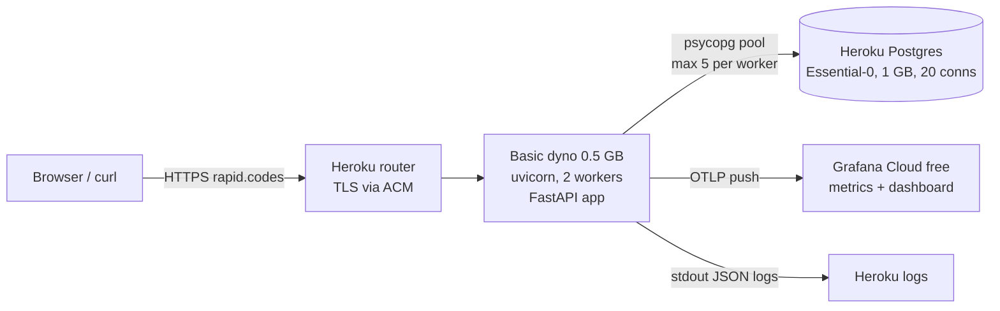

# rapid.codes — v1 Design

Last updated: 2026-10-20 · Requirements live in [SPEC.md](SPEC.md). This document says **how** they are met and **why**.

## 1. Architecture

One FastAPI app on one Heroku Basic dyno, one managed Postgres database, metrics pushed out to Grafana Cloud. No cache and no Redis in v1.



### Request paths

**Redirect (hot path, FR5 redirect / FR6 unknown code / FR7 disabled link)**

1. `GET /{code}` arrives through the Heroku router.
2. If `code` doesn't match `^[0-9A-Za-z]{7}$`, return `404` right away, without touching the DB.
3. `SELECT long_url, status FROM links WHERE code = $1` (a unique-index lookup).
4. No row → `404` page. `status = 'disabled'` → `410` page. Active → `302` with `Location: long_url`.

**Create (FR1 create link / FR2 same URL, same code)**

1. `POST /api/v1/links`: check the rate limit (10 per minute per client IP).
2. Validate (FR4: http/https only, host required, max 2,048 chars, no rapid.codes targets) → `422` on failure.
3. Normalize (FR3: lowercase scheme and host, drop default port, keep path, query and fragment) and compute `url_hash = sha256(normalized)`.
4. Generate a code (FR9: 7 random base62 chars), regenerating it while it's a 7-letter dictionary word (FR10).
5. `INSERT ... ON CONFLICT DO NOTHING RETURNING ...` (see section 2.2).
6. A row came back → `201`. Nothing came back → look up by `url_hash`: found → `200` with the existing link (FR2); not found → the code collided, so go back to step 4 (max 5 attempts, then `500`).

### Code layout (layers, SOLID)

```
app/
  main.py              # app factory; docs_url=None, redoc_url=None, openapi_url=None (no docs route)
  config.py            # pydantic-settings: DATABASE_URL, BASE_URL, OTLP settings
  api/                 # HTTP layer only: parse request, call service, shape response
    links.py           # POST /api/v1/links
    redirect.py        # GET /{code}
    home.py            # GET /
    errors.py          # problem+json handlers (FR11 one error format)
  domain/              # pure logic, no I/O; easiest to unit-test
    normalize.py       # validation + normalization + hashing (FR3, FR4)
    codes.py           # code generator + word blocklist (FR9, FR10)
    models.py          # Link dataclass, LinkStatus enum
  services/
    link_service.py    # create_link / resolve_code; orchestration and retries
  repositories/
    base.py            # LinkRepository Protocol (the interface)
    postgres.py        # psycopg 3 implementation, raw SQL
    in_memory.py       # fake for unit tests
  infra/
    db.py              # AsyncConnectionPool lifecycle
    logging.py         # JSON logs, request_id middleware
    telemetry.py       # OpenTelemetry metrics, OTLP exporter
    ratelimit.py       # in-process sliding window per client IP
  static/index.html    # home page form (FR12)
  data/words7.txt      # 7-letter English word list
migrations/            # Alembic, raw SQL in upgrade()/downgrade()
tests/unit/, tests/integration/, loadtest/
```

- **SRP (single responsibility):** API code knows HTTP, the service knows the rules, the repository knows SQL. None of them knows the others' details.
- **DIP (dependency inversion):** `LinkService` depends on the `LinkRepository` Protocol, not on Postgres. Unit tests inject `InMemoryLinkRepository`. The cache will later be a decorator that implements the same Protocol (`CachedLinkRepository(inner)`), so the service doesn't change.
- Dependencies are wired in `main.py` through FastAPI `Depends`, not with globals.

## 2. Data model

### 2.1 Table

```sql
CREATE TABLE links (
    id          BIGINT GENERATED ALWAYS AS IDENTITY PRIMARY KEY,
    code        VARCHAR(7) COLLATE "C" NOT NULL,
    long_url    TEXT        NOT NULL CHECK (char_length(long_url) <= 2048),
    url_hash    BYTEA       NOT NULL CHECK (octet_length(url_hash) = 32),
    status      TEXT        NOT NULL DEFAULT 'active'
                            CHECK (status IN ('active', 'disabled')),
    created_at  TIMESTAMPTZ NOT NULL DEFAULT now(),
    CONSTRAINT links_code_key     UNIQUE (code),
    CONSTRAINT links_url_hash_key UNIQUE (url_hash)
);
```

| Column | Why |
| --- | --- |
| `id` | Internal key. Never exposed, never used to make codes (that would make codes enumerable). |
| `code` | `COLLATE "C"` compares raw bytes, so `aB3xK9q` ≠ `ab3xk9q` (FR9 case-sensitive codes) and the comparison doesn't depend on locale. |
| `long_url` | The **normalized** URL, which is what gets redirected to. `CHECK` repeats the FR4 length limit, so the DB protects itself even if the app has a bug. |
| `url_hash` | SHA-256 of `long_url`, 32 bytes. Its `UNIQUE` index enforces FR2 (same URL, same code) in the database, which is safe under concurrent requests. A 32-byte index entry beats one of up to 2 KB: the index is smaller, faster and more of it fits in RAM. |
| `status` | `TEXT` + `CHECK` instead of a Postgres `ENUM`: adding a value later is a simple migration. |
| `created_at` | For debugging and a future "newest links" view; costs 8 bytes. |

Size: roughly 0.5 KB per row with indexes, so 100,000 links ≈ 50 MB, about 5% of the 1 GB plan.

### 2.2 Create in one statement

```sql
INSERT INTO links (code, long_url, url_hash)
VALUES ($1, $2, $3)
ON CONFLICT DO NOTHING
RETURNING code, long_url, status, created_at;
```

`ON CONFLICT DO NOTHING` without a target catches **both** unique constraints. If no row is returned, the service runs `SELECT ... WHERE url_hash = $3` to tell which one hit:

- Row found → another request (or an earlier one) already stored this URL → return it with `200` (FR2).
- No row → the random code collided → generate a new code and retry.

Why not "SELECT first, then INSERT": two concurrent requests can both see "not found" and both insert. The unique index is the only thing that's actually safe (ACID: the **C**onsistency comes from constraints, the **I**solation of the check comes from the index, not from app code).

### 2.3 Disabling (FR8: manual SQL)

```sql
UPDATE links SET status = 'disabled' WHERE code = 'aB3xK9q';
```

Run with `heroku pg:psql`. Once the cache exists (v1.x), a disabled link can keep redirecting for up to the cache TTL. That is documented and accepted.

## 3. API

Base URL: `https://rapid.codes`. Errors use `application/problem+json` (FR11 one error format, RFC 9457).

### `POST /api/v1/links`

Request:
```json
{ "url": "https://Example.com:443/docs?q=1#intro" }
```

`201 Created` (new) or `200 OK` (already existed, FR2):
```json
{
  "code": "aB3xK9q",
  "short_url": "https://rapid.codes/aB3xK9q",
  "long_url": "https://example.com/docs?q=1#intro",
  "created_at": "2026-10-20T18:00:00Z"
}
```

| Status | When |
| --- | --- |
| `201` | New link created |
| `200` | Normalized URL already shortened; the existing link is returned |
| `422` | Invalid URL (FR4) or invalid JSON body |
| `429` | Rate limit hit; includes a `Retry-After` header |
| `500` | Code generation failed 5 times in a row (should never happen) |

Error example:
```json
{
  "type": "https://rapid.codes/errors/invalid-url",
  "title": "Invalid URL",
  "status": 422,
  "detail": "Only http and https URLs are allowed.",
  "instance": "/api/v1/links"
}
```

### `GET /{code}`

| Status | When | Body |
| --- | --- | --- |
| `302` | Active link (FR5) | Empty; `Location` header set |
| `404` | Unknown or malformed code (FR6) | Short HTML page |
| `410` | Disabled link (FR7) | Short HTML page |

Header on `302`: `Cache-Control: no-store`, so browsers re-ask every time and disabling takes effect right away.

### `GET /`

Static HTML form (FR12 home page). It calls `POST /api/v1/links` with `fetch` and writes the result with `textContent`, never `innerHTML` (XSS-safe).

### Not exposed

No `/docs`, `/redoc`, `/healthz` or `/metrics`. The OpenAPI schema is exported to `docs/openapi.json` by a script (`python -m scripts.export_openapi`), and CI fails if it's out of date.

## 4. Operational design

| Concern | Design |
| --- | --- |
| Process model | `uvicorn app.main:create_app --factory --workers 2 --proxy-headers --forwarded-allow-ips='*'`. Two workers on 0.5 GB of RAM; measure memory before adding a third. |
| DB connections | `psycopg_pool.AsyncConnectionPool(min_size=1, max_size=5)` per worker → at most 10 of the 20 allowed, leaving room for `psql` and migrations. Little's law: 500 req/s × 2 ms per query ≈ 1 busy connection, so 10 is generous. |
| Migrations | Alembic, run in the Heroku **release phase** (`release: alembic upgrade head` in the Procfile), so a failed migration blocks the deploy. |
| Client IP | Heroku's router appends the real client IP as the **last** `X-Forwarded-For` entry. Use the rightmost value; earlier values are client-controlled and can be faked. |
| Rate limit | In-process sliding window, 10 creates per minute per IP. **Known gap:** each of the 2 workers counts separately, so the real limit is up to 20/min. Accepted for v1; it becomes exact with Redis or with login (limit per user). |
| Logging | JSON lines to stdout: `ts`, `level`, `request_id` (from Heroku's `X-Request-ID`), `method`, `path`, `status`, `duration_ms`. No full client IP, and no long URL at INFO level. |
| Metrics | OpenTelemetry SDK with an OTLP/HTTP exporter to Grafana Cloud, every 60 s: request duration histogram (by route and status), requests per second, error rate, `links_created_total`. Push means no public metrics route, and each worker reports independently. |
| TLS + domain | Heroku ACM (Let's Encrypt) on the Basic dyno. `rapid.codes` needs an ALIAS/CNAME-flattened record pointing at the Heroku DNS target; no AAAA record. |
| Secrets | Heroku config vars (`DATABASE_URL` is set by the add-on). `.env` locally, git-ignored. |
| Load test | k6 against `docker compose` (app + Postgres) on your machine, target 500 RPS on `GET /{code}`, report in `docs/load-test.md`. One extra run against Heroku, reported separately and honestly. |

## 5. Decisions and reasons

Each decision gets a short ADR in `docs/adr/` (tasks.md T20). Decisions made after this document (D13 onward) are logged in [decisions.md](decisions.md).

| # | Decision | Alternatives rejected | Why |
| --- | --- | --- | --- |
| D1 | **302** redirect | 301 | Browsers cache 301s forever, which would make disabling (FR7 disabled link) and future click stats impossible. Cost: every click hits the server. |
| D2 | **FastAPI** | Flask | Built-in request validation (Pydantic), async I/O for many concurrent DB waits, auto-generated OpenAPI schema. |
| D3 | **Random 7-char base62 + DB uniqueness retry** | Counter → base62; counter + shuffle; truncated hash | Unguessable and not enumerable; easy to reason about and test. Collision chance at 100k links ≈ 3 in 100 million per insert. |
| D4 | **7-letter English word blocklist** (FR10) | No filter; profanity-only filter | Cheap (~30k words vs 3.5 trillion codes). Known limitation: lookalikes like `passw0rd` pass. Not a focus of the project. |
| D5 | **PostgreSQL** | MongoDB, Redis as primary store | `UNIQUE` + transactions make FR2 (same URL, same code) safe under concurrency; ACID is a project goal; fits inside the Heroku credit. |
| D6 | **`UNIQUE` on SHA-256 of the normalized URL** | `UNIQUE` on the URL text | 32-byte index entries instead of up to 2 KB: smaller, faster index. Collisions are practically impossible (2²⁵⁶). |
| D7 | **psycopg 3 + raw SQL** | SQLAlchemy ORM, asyncpg | One driver for both the app and Alembic; raw SQL keeps the hot path visible and teaches SQL; async pool built in. |
| D8 | **Heroku Basic + Postgres Essential-0** via the Student Pack ($13/month credit for 24 months) | Render + Neon + Upstash (free but sleeps: ~1 min cold start); Azure VM ($100 credit, self-managed) | Always on, so the CV link works instantly; managed DB with persistent disk and backups; $12/month fits the credit. After 24 months: ~$144/year. |
| D9 | **No cache in v1**; later an in-process TTL cache | Redis | Measure first. With one dyno an in-process cache is faster than Redis and free. Redis only makes sense with 2+ instances, which is over budget. |
| D10 | **Metrics pushed via OTLP** | Public `/metrics` scraped by Prometheus | No extra public route; works the same with any number of workers. |
| D11 | **Manual SQL disabling** (FR8) | Admin endpoint, CLI script | No users and no admin in v1; the smallest possible surface. |
| D12 | **Docs on GitHub only** | `/docs` route | Smaller public surface; the README and `openapi.json` are what reviewers read anyway. |

## 6. Known risks (carried from the spec)

- Abuse and phishing on a public anonymous shortener; the domain could get blocked. Google login (considered for v1.1) is the strongest fix.
- 500 RPS is proven locally only; Heroku numbers may be lower (shared CPU, extra router hop).
- Credit ends after 24 months.
- `.codes` renewal costs more than the hosting (~$55–103/year depending on registrar).

## 7. After v1 (not committed)

- **v1.1 Google login:** OAuth with Authlib, `users` table, `links.user_id`, rate limit per user, FR2 dedup per user; redirects stay public.
- **v1.2 Cache:** `CachedLinkRepository` decorator, `TTLCache` with ~60 s TTL, measured before and after with the same k6 script.
